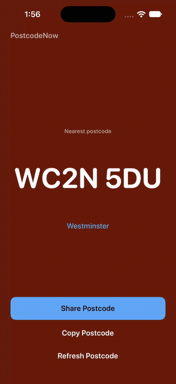
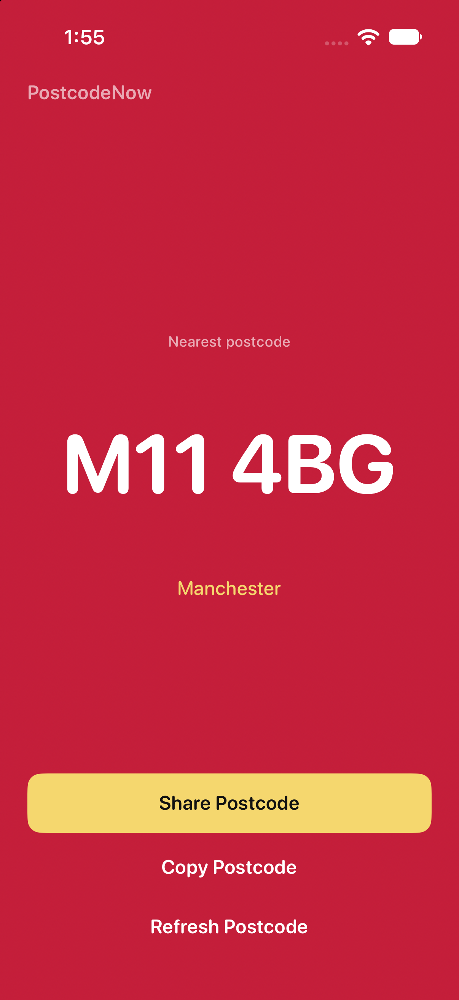
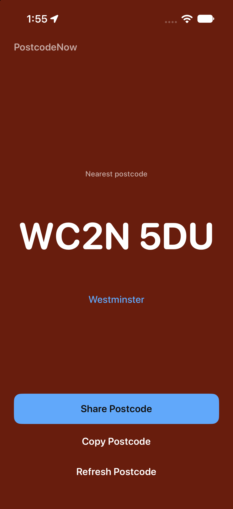
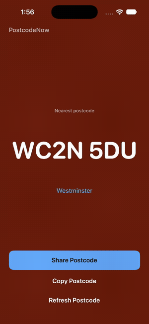
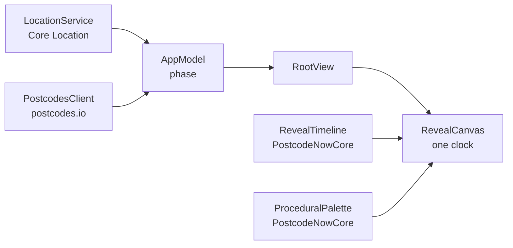

<p align="center">
  
</p>

<h1 align="center">PostcodeNow</h1>

<p align="center">Your postcode, now.</p>

Someone on the phone asks for your postcode and you are not at home. A taxi app wants it, a delivery driver needs it, a form will not go on without it. Maps shows you a pin, not a code, so you end up guessing from a street sign or searching an address you do not know.

PostcodeNow does one thing. Open it and it finds the nearest UK postcode to where you are standing, sets it large on a colour that belongs to that place, and lets you share or copy it. No account, no map, no settings.

## Try it

<p align="center">
  
  
  
  
</p>

Full-quality clips: [reveal.mp4](docs/media/reveal.mp4) · [reveal-and-actions.mp4](docs/media/reveal-and-actions.mp4)

There is no App Store build yet. Build it from source (see [Running locally](#running-locally)); it needs location, so a device or a simulator with a simulated UK location.

## How it feels

**The reveal**

- **Scanning.** Rings loop while Core Location finds you, for as long as it takes.
- **Lock.** The rings collapse from wherever they were into a lock, stretch into a line, and the postcode rises off it one character at a time.
- **Place colour.** The colour floods out from the code itself. Every UK outcode has its own colour, generated in OKLCH from the outcode and held to a 4.5:1 contrast floor, so a postcode always looks the same and its neighbours look different.
- **Haptics.** A firm tap as the lock lands, then a soft tap per character. With Reduce Motion on, the screen arrives settled and one confirmation tap still fires.
- **Skip.** A tap during the reveal jumps straight to the settled screen.

**After it lands**

- **Share Postcode** opens the system share sheet.
- **Copy Postcode** copies the code; the postcode pulses as the toast drops in.
- **Refresh Postcode** locates you again and replays the reveal.
- **Auto-refetch.** Coming back to the app after five minutes, or with an outdated result, looks again on its own.
- **Honest edges.** Offline shows the last postcode from this session, marked as possibly outdated. An approximate fix says so. Outside the UK, and in Northern Ireland, which PostcodeNow does not cover yet, it tells you plainly.

## Built with

| Tool | What it does in PostcodeNow |
|---|---|
| **SwiftUI** | Every screen. One `RevealCanvas` stays alive from search to settle, driven by a single `Animatable` clock |
| **Core Location** | A one-shot `requestLocation()` at best accuracy, with reduced-accuracy detection |
| **postcodes.io** | Reverse lookup from coordinates to the nearest postcode and district |
| **UIKit haptics** | `UIImpactFeedbackGenerator`, scheduled against the reveal's declared cues |
| **Swift Package (`PostcodeNowCore`)** | Pure, UI-free logic: postcode parsing, palette, reveal timeline, haptic cues, share text, lookup client |
| **XCTest** | `swift test` against the core package |

No third-party dependencies.

## Architecture



The whole four-act reveal is a pure function of time in `PostcodeNowCore`, with no UIKit or SwiftUI in it. That is what makes the motion testable: the app only samples the timeline and draws the frame.

| Path | What it is |
|---|---|
| `PostcodeNow/` | The app: `RootView`, `RevealCanvas`, `PlaceExperience`, edge screens, controls, haptics, location |
| `Sources/PostcodeNowCore/` | The core package: postcode parsing, OKLCH palette, reveal timing and timeline, lookup client |
| `Tests/PostcodeNowCoreTests/` | Unit tests for the core package |
| `docs/` | Design spec, plan and README media |

## Running locally

Needs **Xcode 15 or later** and an **iOS 17** simulator or device. Portrait only.

```sh
git clone https://github.com/tade-dev/Postcode-Now.git
cd Postcode-Now
open PostcodeNow.xcodeproj
```

Run the **PostcodeNow** scheme. In the simulator, set a UK location first (Features → Location → Custom Location, e.g. 51.501, -0.1416).

## Tests

```sh
swift test
```

69 tests covering postcode parsing, the place palette and its contrast floors, reveal timing and timeline, haptic cues, hero metrics, share text and the Info.plist contract.

## Licence

MIT. See [LICENSE](LICENSE).

## Credits

Designed and built in 2026 by **Akintade Oluwaseun**.
